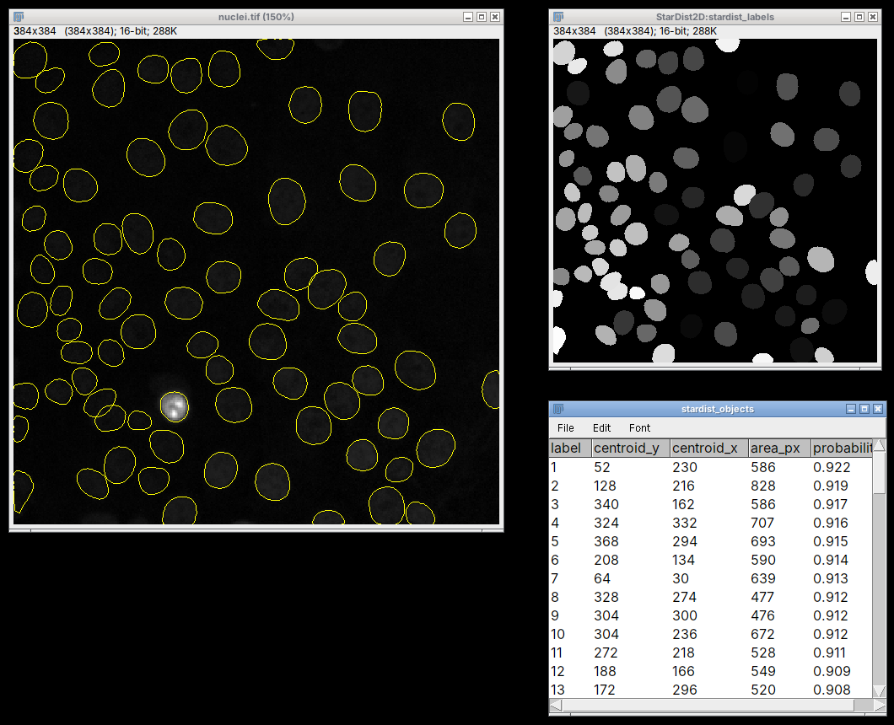

# LabConstrictor for Fiji

Run the analysis tools of your LabConstrictor apps from inside [Fiji](https://fiji.sc). One menu entry lists every installed app; you pick a tool, fill in a normal Fiji dialog and press **OK**. Results come back as image windows, outlines on your image, Results tables and lines in the Log window. The analysis runs in the app's own Python environment, so Fiji needs no Python setup.

*The StarDist2D app's "Segment nuclei" tool, run from Fiji on an open image: outlines on the image, a label image and a table.*

## Install

Download the jar from the [Releases page](https://github.com/CellMigrationLab/LabConstrictor-Fiji/releases) into `Fiji.app/plugins` and restart Fiji. The full steps, how to use it and what to do when something goes wrong are in the [Fiji guide](https://cellmigrationlab.github.io/LabConstrictor-Site/guides/fiji/).

Any LabConstrictor app that declares Fiji as a host appears in the menu. The [App Centre](https://cellmigrationlab.github.io/LabConstrictor-Site/apps/?host=fiji) lists them.

## More

- [Technical reference](docs/REFERENCE.md): every rule the plugin follows, running a tool from a macro, and how to build and test the plugin.
- Bugs and questions: the [issue tracker](https://github.com/CellMigrationLab/LabConstrictor-Fiji/issues).
- The same apps also run in [napari](https://github.com/CellMigrationLab/LabConstrictor-napari) and [QuPath](https://github.com/CellMigrationLab/LabConstrictor-QuPath). To make your own app, start at the [LabConstrictor website](https://cellmigrationlab.github.io/LabConstrictor-Site/).

License: [MIT](LICENSE).
