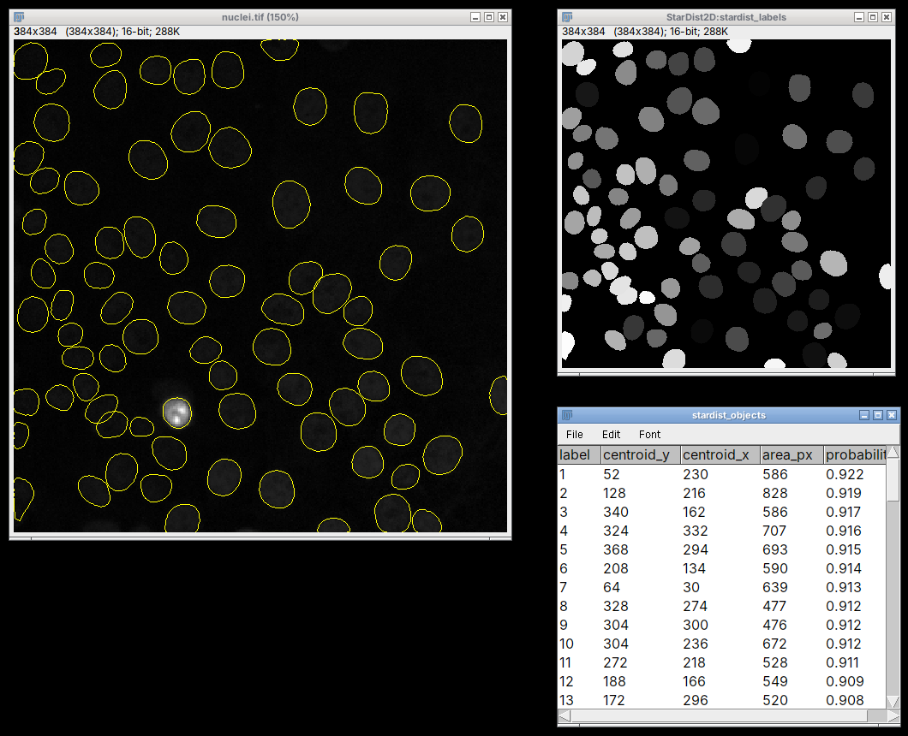
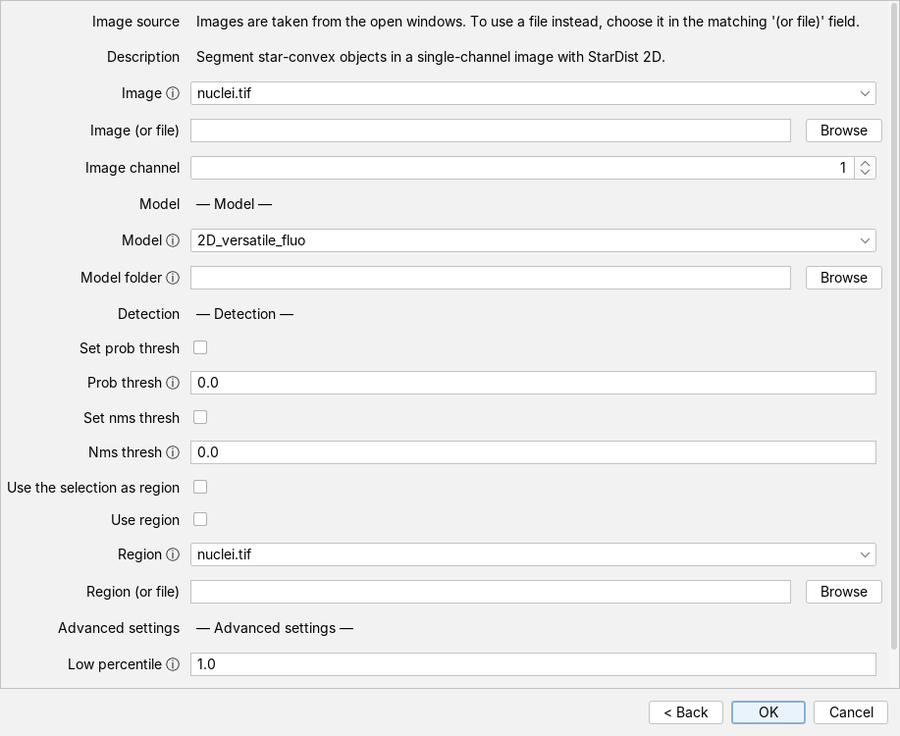

# Install the Fiji plugin

Run the tools of your LabConstrictor apps from Fiji (ImageJ): one menu entry lists every installed app, you pick a tool, fill in a normal Fiji dialog, and the results open as image windows, outlines, tables and Log lines.

## What you need

- [Fiji](https://fiji.sc).
- At least one LabConstrictor app that works in Fiji. The [App Centre](https://cellmigrationlab.github.io/LabConstrictor-Site/apps/?host=fiji) lists them. Installing the app and installing this plugin are two separate steps: the app's installer registers the app on your computer, which is how the plugin finds it.
- Nothing else: you do not need Java, Maven or Python of your own.

## Install

The current version is `v0.1.0-alpha.7`.

1. Download [`labconstrictor-fiji-v0.1.0-alpha.7.jar`](https://github.com/CellMigrationLab/LabConstrictor-Fiji/releases/download/v0.1.0-alpha.7/labconstrictor-fiji-v0.1.0-alpha.7.jar). Newer versions, when there are any, are on the [Releases page](https://github.com/CellMigrationLab/LabConstrictor-Fiji/releases).
2. Put it into the `plugins` folder of your Fiji (`Fiji.app/plugins/`, not a subfolder). Remove any older `labconstrictor-fiji-*.jar` from that folder.
3. Restart Fiji.

There is no Fiji update site yet, so to update you repeat these steps with the newer file.

Without the jar: the same release has `labconstrictor-fiji-script-v0.1.0-alpha.7.zip`. Unzip it so that the script `LabConstrictor_Tools.groovy` and its `lib` folder both sit in `Fiji.app/scripts/Plugins/LabConstrictor/`. The menu entry is then **Plugins > LabConstrictor > LabConstrictor Tools** (no dots). Install the jar or the script, not both, or the menu lists the tool twice. Running a tool from a macro needs the jar.

## Open it

1. Open an image in Fiji.
2. Choose **Plugins > LabConstrictor > LabConstrictor Tools...**
3. Pick an app, then a tool. A list with only one entry is skipped.
4. Fill in the dialog and press **OK**. Hover over a label with an **ⓘ** to read what the setting means.

When the run ends, the same dialog opens again with the values you used, ready for the next run. Change what you need and press **OK** again, or press **Cancel** when you are done. **< Back** takes you one step back: from the dialog to the list of tools, and from there to the list of apps.

Good to know:

- Each image input has a chooser for an open image and an "(or file)" field. If you give both, the file is used. After a run the "(or file)" field is empty again, so the next run uses the open image.
- Results open as image windows, a Results table, outlines or points on the image, or lines in the Log window.
- A progress bar shows while a tool runs, and the Log window shows the tool's progress messages (at most one every 10 seconds). After a minute without news, the Log says the tool is still running. Press **Esc** to cancel.
- After every run, the Log window shows a terminal command and a Python snippet that repeat the run outside Fiji.
- While the dialog is open you cannot use other Fiji windows. To zoom or to open another image, press **Cancel**, then start the tool from the menu again. The menu remembers the app and tool you used last.
- A pixel-size setting follows the image's calibration until you type a value.

## Check that it worked

Install the [Playground](https://cellmigrationlab.github.io/LabConstrictor-Site/apps/labconstrictor-playground/) app, choose it in the menu and run its **Feature tour** tool with every field left as it is: the tool makes its own small demo image. You should get a label image, tables, and the message "Found 16 blob(s)".

## If something does not work

- **No menu entry.** The jar is not directly in `Fiji.app/plugins/`, or Fiji was not restarted.
- **"No LabConstrictor apps are registered".** No LabConstrictor app is installed yet. Install one, then start the tool again.
- **An app is missing from the list.** The Log window says why: the app may not offer its tools in Fiji, it may have been installed with an old installer (install its newest version), or it may need a newer version of this plugin (the Log names the version to get).
- **A run fails.** The error dialog shows the tool's error and where the log file is: `~/.labconstrictor/logs/labconstrictor.log`.
- **The pixel-size field was cleared and the run was refused.** The image has no usable calibration, so nothing is assumed: type the pixel size. This also happens if you type exactly the value the field already showed; type it again.
- **You want to know which apps are found.** `labconstrictor-tools doctor`, run in a terminal, shows which apps are registered and why one might be skipped.
- **You want to report a bug.** Open an [issue](https://github.com/CellMigrationLab/LabConstrictor-Fiji/issues) with what you ran and what you saw.

Every rule the plugin follows, and how to run a tool from a macro: [technical reference](https://github.com/CellMigrationLab/LabConstrictor-Fiji/blob/main/docs/REFERENCE.md). Source code and issues: [LabConstrictor-Fiji](https://github.com/CellMigrationLab/LabConstrictor-Fiji).
